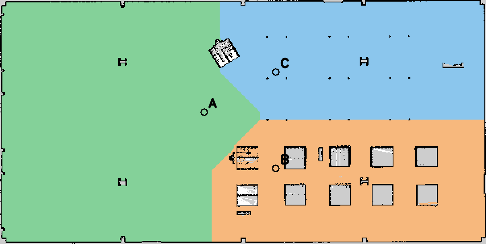

# Bài 7 — Phân vùng bản đồ và điều hướng TurtleBot 4 bằng giọng nói

Nguyễn Minh Nghĩa · **23020755** · K68 E RE.

Repo độc lập cho Bài 7: phân vùng bản đồ Depot thành A/B/C, gắn nhãn ngữ nghĩa,
nhận giọng nói tiếng Việt bằng Whisper và điều hướng Nav2 theo thứ tự đích.
Đã kiểm chứng trên **Ubuntu 24.04 / ROS 2 Jazzy / Gazebo Harmonic**. Đề yêu cầu
22.04 / Humble; môi trường Humble chưa được kiểm thử.



- [Báo cáo PDF hai trang — cùng mẫu các tuần trước](docs/reports/Bao_cao_TurtleBot4_Phan_vung_Giong_noi_Bai7.pdf)
- [Google Drive — giữ nguyên thư mục nộp bài các tuần trước](https://drive.google.com/drive/u/1/folders/1KpX5KTfOAgTgpQlJO7Gp-5q5eNcDs8VM)
- [Hướng dẫn chi tiết package](src/tb4_voice_navigation/README.md)
- [Kết quả kiểm chứng, giới hạn và kịch bản demo](docs/lab7/validation.md)

## Chức năng

| Câu nói | Tuyến / kết quả |
|---|---|
| Đi đến vùng A / khu vực A / phòng học | A |
| Đi đến vùng B / phòng thí nghiệm | B |
| Đi đến vùng C / hành lang | C |
| Di chuyển từ khu vực A đến khu vực B | A → B, kể cả khi robot đang ở vùng khác |
| Đi từ phòng A qua hành lang C rồi đến phòng B | A → C → B |
| Đi đến vùng Z | Từ chối toàn bộ lệnh, không gửi đích mới |
| Dừng lại / Hủy lệnh | Hủy tuyến đang chạy |

Nhận dạng theo lượt: nhấn Enter rồi nói trong khoảng thu 6 giây. Chưa hỗ trợ
lệnh vận tốc tương đối như rẽ trái/phải hoặc tiến một mét. Khi robot đang chạy,
lệnh đi mới bị từ chối; chờ hoàn thành hoặc hủy tuyến trước.

## Cấu trúc

- `src/tb4_voice_navigation`: segmentation, cấu hình vùng, hai node ROS và kiểm thử.
- `src/tb4_simulation_lab`: baseline Depot + AMCL/Nav2 tối thiểu để repo chạy độc lập.
- `docs/lab7`: báo cáo, ảnh, quỹ đạo, dữ liệu kiểm chứng và script tạo lại PDF.
- `requirements-voice.txt`: thư viện nhận dạng; không đưa trọng số mô hình lên Git.

## Cài đặt

```bash
git clone https://github.com/ngaingu-05/turtlebot4-voice-navigation-lab7.git
cd turtlebot4-voice-navigation-lab7
source /opt/ros/jazzy/setup.bash
sudo apt install ros-jazzy-turtlebot4-simulator ros-jazzy-nav2-bringup \
  ros-jazzy-navigation2 python3-colcon-common-extensions python3-venv \
  python3-opencv python3-numpy python3-yaml python3-pytest libportaudio2 \
  python3-reportlab fonts-dejavu-core
python3 -m venv --system-site-packages .venv-voice
.venv-voice/bin/python -m pip install -r requirements-voice.txt
colcon build --symlink-install --packages-select tb4_simulation_lab tb4_voice_navigation
source install/setup.bash
```

Tải Whisper **một lần** khi có mạng, lưu vào thư mục riêng để các lần chạy sau
không phụ thuộc việc truy cập Hugging Face:

```bash
.venv-voice/bin/python - <<'PY'
from huggingface_hub import snapshot_download
snapshot_download('Systran/faster-whisper-small', local_dir='models/whisper-small',
                  allow_patterns=['model.bin', 'config.json', 'tokenizer.json', 'vocabulary.txt'])
PY
```

Không dùng model `.en` cho tiếng Việt. `av==16.0.1` đã được ghim vì PyAV 19 không
hỗ trợ tham số đọc audio mà faster-whisper 1.2.1 sử dụng.

## Chạy demo

Mỗi terminal đặt thư mục hiện tại về repo và chạy:

```bash
source /opt/ros/jazzy/setup.bash
source install/setup.bash
export ROS_DOMAIN_ID=42
```

Terminal 1 — Gazebo Depot:

```bash
ros2 launch tb4_simulation_lab gazebo_rviz.launch.py
```

Terminal 2 — AMCL và Nav2:

```bash
ros2 launch tb4_simulation_lab localization_navigation.launch.py \
  map:=$PWD/src/tb4_voice_navigation/maps/map.yaml
```

Terminal 3 — nhận lệnh và RViz Bài 7:

```bash
ros2 launch tb4_voice_navigation voice.launch.py rviz:=true goal_timeout:=300.0
```

Terminal 4 — chuẩn bị robot và micro:

```bash
ros2 action send_goal /undock irobot_create_msgs/action/Undock '{}'
```

Chờ undock `SUCCEEDED`. Trong RViz Bài 7, dùng **2D Pose Estimate** để đặt vị trí
và hướng robot khớp Gazebo. Với robot mặc định vừa undock trong Depot, vị trí
xấp xỉ x=−0,35 m, y=0 m, đầu hướng về chiều x âm; kiểm tra lại theo scene hiện tại.
Nav2 cần initial pose để có transform `map → odom`.

```bash
ros2 lifecycle get --no-daemon --spin-time 5 /bt_navigator
# Chờ active [3], rồi chạy micro:
HF_HUB_OFFLINE=1 .venv-voice/bin/python \
  src/tb4_voice_navigation/scripts/speech_recognition_node --model models/whisper-small
```

Nhấn Enter, nói “Đi đến vùng A”, xem transcript và robot di chuyển. Muốn thử
nhận dạng mà không điều khiển robot, thêm `--dry-run`. Liệt kê micro bằng
`--list-devices`; chọn thiết bị bằng `--device <số>`.
Lệnh dừng giọng nói có độ trễ thu/nhận dạng, không phải dừng khẩn cấp.

Có thể kiểm tra riêng điều hướng bằng lệnh văn bản:

```bash
ros2 topic pub --once /voice_nav/text std_msgs/msg/String "{data: 'Đi đến vùng A'}"
ros2 topic echo /voice_nav/status
```

## Kiểm thử

```bash
python3 -m pytest src/tb4_voice_navigation/test/test_core.py -q
colcon test --packages-select tb4_voice_navigation
colcon test-result --verbose
# Action server GIẢ; dùng domain khác với phiên mô phỏng đang chạy:
ROS_DOMAIN_ID=73 python3 src/tb4_voice_navigation/test/check_ros_integration.py
# ASR trên các MP3 tổng hợp đã lưu; không gửi goal:
.venv-voice/bin/python docs/lab7/check_synthetic_speech.py --model small --source gtts
python3 docs/lab7/create_report.py
```

Kết quả đã ghi nhận: **39/39 unit tests**, **11/11 tình huống ROS giả**,
**3/3 ca Nav2 thật với đầu vào văn bản**, **3/3 câu Google TTS với Whisper small**.
Micro thực đã được thử; B và C hoàn tất trong log sau khi sửa bí danh “vùng”.
Bản ghi B được gọi khi robot đã đứng ở B. eSpeak cho kết quả 0/3, không dùng để
đại diện chất lượng trên giọng người. Chưa đo WER/accuracy giọng người.

Các WAV micro riêng tư, môi trường Python, build/install/log và trọng số không
nằm trong bản phát hành. Audio tổng hợp dùng kiểm thử có ghi rõ nguồn. Drive là
thư mục dùng chung từ tuần trước; `video_url` vẫn để trống tới khi xác nhận video
Bài 7 cụ thể. Giấy phép mã nguồn: Apache-2.0.
