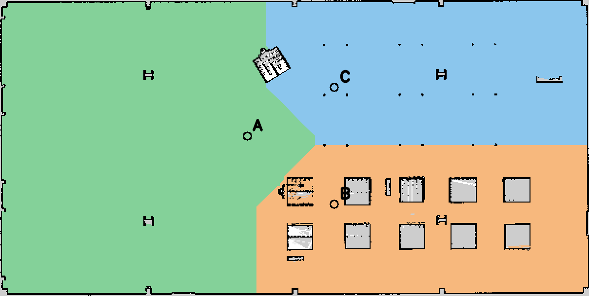
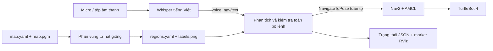

# Bài 7 — Phân vùng bản đồ và điều hướng bằng giọng nói

Package `tb4_voice_navigation` xử lý bản đồ Occupancy Grid, gắn nhãn A/B/C,
nhận câu tiếng Việt bằng Whisper chạy cục bộ và gửi tuần tự action Nav2.





## Môi trường và cài đặt

Đề yêu cầu Ubuntu 22.04 / ROS 2 Humble. Máy triển khai hiện có Ubuntu 24.04 /
ROS 2 Jazzy; các kiểm tra tại workspace này dùng Jazzy. Package dùng API
`NavigateToPose` có trên Humble/Jazzy, nhưng **chưa kiểm thử trên Humble**.
Các launch simulator/Nav2 cũ của `tb4_simulation_lab` dành cho Jazzy/Harmonic;
trên Humble cần chạy simulator và Nav2 tương ứng Humble của TurtleBot 4.

```bash
cd ~/turtlebot4-voice-navigation-lab7
source /opt/ros/jazzy/setup.bash
sudo apt install python3-opencv python3-numpy python3-yaml python3-pytest \
  python3-venv python3-colcon-common-extensions python3-reportlab libportaudio2
python3 -m venv --system-site-packages .venv-voice
.venv-voice/bin/python -m pip install -r requirements-voice.txt
colcon build --symlink-install --packages-select tb4_simulation_lab tb4_voice_navigation
source install/setup.bash
```

Simulator/Nav2 cần đã cài theo hướng dẫn [README workspace](../../README.md).
Whisper mặc định dùng `small` đa ngôn ngữ, CPU int8; lần đầu tải trọng số từ mạng.
Có thể dùng `--model /đường/dẫn/model` để chạy hoàn toàn offline sau khi tải.
Không dùng model `.en` cho tiếng Việt. Venv cần cùng phiên bản Python với ROS.
Có thể thử `--model base` khi máy ít tài nguyên; trong bộ âm thanh Google TTS ở
workspace này, base đạt 2/3 câu, small đạt 3/3. Đây là âm thanh tổng hợp, cần đánh
giá lại bằng giọng người dùng.

## Phân vùng và gắn nhãn

Bản đồ Depot là kho mở, không có ba phòng kín. Tên Phòng học / Phòng thí nghiệm /
Hành lang là **nhãn chức năng do người dùng gán**, không phải kết quả nhận dạng
chức năng phòng từ ảnh.

1. Đọc resolution, origin (gồm yaw), negate và ngưỡng occupancy trong `map.yaml`.
2. Chỉ giữ ô có occupancy nhỏ hơn `free_thresh`; vật cản và ô chưa biết bị loại.
3. Lan truyền đồng thời từ ba hạt giống theo lưới 4 lân cận, không xuyên vật cản.
   Mỗi ô trống nhận nhãn hạt giống có khoảng cách đường đi ngắn nhất (geodesic Voronoi).
4. Distance transform tính khoảng cách tới vật cản và mép ảnh; trừ nửa đường chéo
   một ô để bù diện tích ô vật cản. Chọn ô gần hạt giống nhất có clearance ≥0,4 m.
   Cả ba đích phải thuộc cùng một thành phần liên thông của lưới có clearance này.
5. Xuất ảnh màu, ảnh nhãn uint16, bản đồ gốc và YAML vùng; các đảo trống không nối
   đến hạt giống giữ nhãn 0. Khoảng hở bản đồ tĩnh không chứng minh vật cản động
   đã được tránh: Nav2 tiếp tục dùng LiDAR/costmap khi điều hướng.

```bash
python3 src/tb4_voice_navigation/scripts/segment_map \
  --map src/tb4_simulation_lab/maps/map.yaml \
  --seeds src/tb4_voice_navigation/config/seeds.yaml \
  --output src/tb4_voice_navigation/maps --clearance 0.4
```

Sau khi sửa bản đồ/hạt giống hãy chạy lại lệnh trên, rồi build lại khi không dùng
symlink install. Không chỉnh tọa độ đích tùy ý: node kiểm tra fingerprint bản đồ,
nhãn vùng và clearance lúc khởi động.

Với pixel `(u,v)` ảnh cao `H`, tọa độ cục bộ tâm ô là
`qx=(u+0.5)*resolution`, `qy=(H-v-0.5)*resolution`.
Tọa độ ROS: `x=ox+cos(yaw)*qx-sin(yaw)*qy`,
`y=oy+sin(yaw)*qx+cos(yaw)*qy`.

| ID | Tên chức năng | Đích x, y (m) | Clearance (m) |
|---|---|---|---|
| A | Phòng học | −2,468; 0,503 | 2,87 |
| B | Phòng thí nghiệm | 1,982; −2,997 | 0,51 |
| C | Hành lang | 1,982; 3,003 | 0,57 |

## Chạy trong mô phỏng Jazzy

Mỗi terminal source `/opt/ros/jazzy/setup.bash` và `install/setup.bash` tại workspace,
đồng thời dùng cùng `ROS_DOMAIN_ID`. Dừng node cử chỉ/teleop còn chạy trước demo.

Terminal 1 — mô phỏng Depot và RViz:

```bash
ros2 launch tb4_simulation_lab gazebo_rviz.launch.py
```

Terminal 2 — AMCL + Nav2 trên đúng bản đồ:

```bash
ros2 launch tb4_simulation_lab localization_navigation.launch.py \
  map:=$PWD/src/tb4_voice_navigation/maps/map.yaml
```

Đợi Nav2 active, dùng **2D Pose Estimate** trong RViz để đặt vị trí robot đúng
với Gazebo. Robot spawn trên dock: thực hiện undock rồi chờ action thành công.

```bash
ros2 action send_goal /undock irobot_create_msgs/action/Undock '{}'
ros2 action list
ros2 lifecycle get /bt_navigator
ros2 topic hz /scan
```

Terminal 3 — bộ nhận lệnh và điều hướng:

```bash
ros2 launch tb4_voice_navigation voice.launch.py
# Thêm rviz:=true để mở RViz riêng với map, nhãn vùng, LiDAR và đường Nav2.
```

Terminal 4 — micro tương tác, nhấn Enter trước mỗi câu (thu mặc định 6 giây):

```bash
.venv-voice/bin/python src/tb4_voice_navigation/scripts/speech_recognition_node \
  --save-dir docs/lab7/audio
# Liệt kê thiết bị: thêm --list-devices
# Chọn micro: thêm --device 2
# Nhận dạng thử, không gửi goal: thêm --dry-run
# Nhận dạng một tệp thay micro:
.venv-voice/bin/python src/tb4_voice_navigation/scripts/speech_recognition_node \
  --audio /đường/dẫn/cau_lenh.wav
```

Các câu hỗ trợ:

- “Đi đến khu vực A.” → A.
- “Đi đến vùng A/B/C.” → vùng tương ứng (nói một tên vùng mỗi lần).
- “Di chuyển từ khu vực A đến khu vực B.” → A, sau khi thành công mới đến B.
- “Đi đến phòng thí nghiệm.” → B.
- “Đi từ phòng A qua hành lang C rồi đến phòng B.” → A → C → B.
- “Đi đến khu vực Z.” → thông báo lỗi, không gửi goal.
- “Dừng lại.” / “Hủy lệnh.” → hủy tuyến hiện tại.

Tiếng Việt được bỏ dấu, chuẩn hóa hoa/thường và đối chiếu **toàn bộ tên vùng**,
không khớp chuỗi con. Lệnh chứa vùng lạ bị từ chối toàn bộ, kể cả vùng lạ nằm giữa
tuyến. Lệnh phủ định/mơ hồ không được hiểu thành lệnh đi. Khi robot đang chạy,
lệnh đi mới bị từ chối; lệnh dừng vẫn được xử lý. Mỗi chặng có timeout theo đồng hồ
thực (mặc định 180 giây, chỉnh `goal_timeout:=300.0`). Thất bại/từ chối/hủy ở bất kỳ
chặng nào sẽ dừng cả tuyến. Nếu mất phản hồi action, node giữ trạng thái bận để
tránh gửi chồng goal; kiểm tra trạng thái robot/Nav2 trước khi khởi động lại.

Whisper dùng VAD, lọc đoạn có `no_speech_prob ≥ 0.6` hoặc `avg_logprob < −1`;
micro quá nhỏ cũng bị bỏ qua. Các ngưỡng này không phải xác suất lệnh đúng.
Push-to-talk giảm thu nhầm tiếng nói nền; vẫn cần thử bằng giọng người dùng.
Lệnh dừng bằng giọng nói chịu độ trễ thu âm/nhận dạng; dùng cơ chế dừng của robot
khi cần dừng tức thời.

Theo dõi trạng thái:

```bash
ros2 topic echo /voice_nav/status
ros2 topic echo /voice_nav/transcript
```

RViz: thêm display `MarkerArray`, topic `/voice_nav/markers`, QoS durability
`Transient Local` để thấy nhãn và thứ tự các điểm. Đường nối marker chỉ biểu diễn
thứ tự đích, **không phải đường tránh vật cản**. Xem topic `/plan` của Nav2 để thấy
đường thực do planner tính.

Có thể kiểm tra riêng bộ phân tích, bỏ qua nhận dạng giọng nói:

```bash
ros2 topic pub --once /voice_nav/text std_msgs/msg/String "{data: 'Đi đến khu vực A'}"
```

## Kiểm thử và bài nộp

```bash
python3 -m pytest src/tb4_voice_navigation/test/test_core.py -q
colcon test --packages-select tb4_voice_navigation
colcon test-result --verbose
# Kiểm tra DDS và action bằng server GIẢ, không chuyển động robot:
ROS_DOMAIN_ID=73 python3 src/tb4_voice_navigation/test/check_ros_integration.py
python3 docs/lab7/create_report.py
```

Xem [hướng dẫn kiểm chứng / quay video](../../docs/lab7/validation.md) và
[báo cáo PDF hai trang](../../docs/lab7/report.pdf). Kết quả unit test / action giả
không thay thế thực nghiệm giọng nói → robot chạy. Các liên kết nộp source public
và video lưu trong `docs/lab7/submission.json`.
Repo Bài 7: [turtlebot4-voice-navigation-lab7](https://github.com/ngaingu-05/turtlebot4-voice-navigation-lab7).
Drive dùng chung từ các tuần trước: [thư mục nộp bài](https://drive.google.com/drive/u/1/folders/1KpX5KTfOAgTgpQlJO7Gp-5q5eNcDs8VM).
Đã thử micro trực tiếp, log xác nhận lệnh B và C hoàn tất sau khi bổ sung cách gọi
“vùng A/B/C”. Chưa có thống kê WER/accuracy hoặc URL video Bài 7 được kiểm chứng.
Whisper small nhận đúng 3/3 câu tổng hợp Google TTS và chọn đúng tuyến; base đạt
2/3. Bộ eSpeak khó nhận dạng, cả hai mô hình đều 0/3. Cần kiểm tra/hiệu chỉnh bằng
giọng người trước khi nộp; các bản ghi tổng hợp không thay thế video dùng micro.

Tài liệu gốc: [faster-whisper](https://github.com/SYSTRAN/faster-whisper),
[NavigateToPose Humble](https://api.nav2.org/actions/humble/navigatetopose.html),
[Nav2 map I/O](https://github.com/ros-navigation/navigation2/blob/humble/nav2_map_server/src/map_io.cpp).
